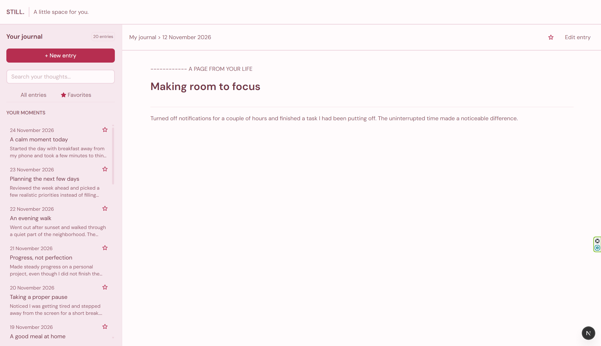
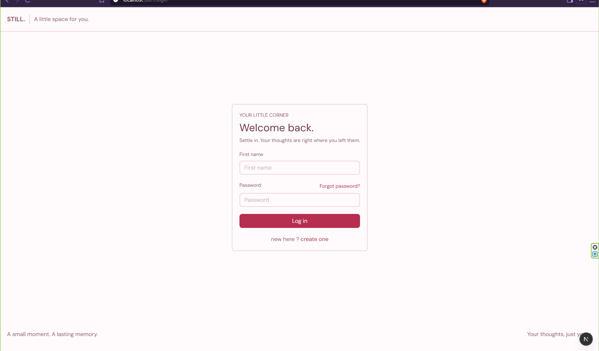
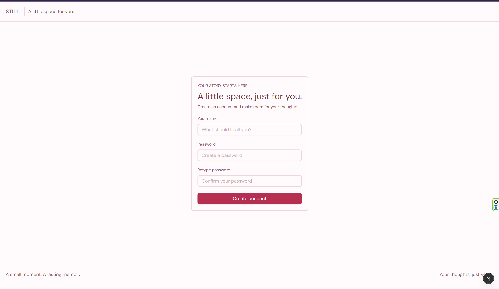

# Diary App

A simple and personal journaling web application to capture, organize, and revisit your daily thoughts, moments, and reflections.

> **Backend:** This frontend connects to the [Diary Entry Backend](https://github.com/Shruthikshetty/diary-entry-backend). See the backend repository for server setup and API documentation.

## Screenshots

### Home / Journal View


### Authentication
| Login | Sign Up |
| :---: | :---: |
|  |  |

## Features

- **Daily Journaling**: Write and save your daily entries with a clean, distraction-free interface.
- **Your Moments**: Easily browse through past entries organized chronologically.
- **Favorites**: Mark and revisit meaningful memories anytime.
- **Quick Editing & Deletion**: Update, refine, or delete past entries with ease.
- **Authentication**: Sign up, log in, and reset your password with cookie-based session handling.

## Tech Stack

- **Framework**: [Next.js](https://nextjs.org) 16 (App Router) & [React](https://react.dev) 19
- **Styling**: [Tailwind CSS](https://tailwindcss.com) v4
- **Language**: TypeScript

## Getting Started

### Prerequisites

- Node.js (v20+ recommended) and npm
- A running instance of the [diary-entry-backend](https://github.com/Shruthikshetty/diary-entry-backend) service (refer to its documentation for setup and API endpoints)

### Setup

1. Install dependencies:

   ```bash
   npm install
   ```

2. Configure environment variables by creating a `.env.local` (or `.env`) file in the project root:

   ```env
   NEXT_PUBLIC_BACKEND_URL=http://localhost:3000
   ```

   Replace the URL with the address where your backend server is running.

3. Run the development server:

   ```bash
   npm run dev
   ```

4. Open [http://localhost:3001](http://localhost:3001) in your browser.

## Scripts

- `npm run dev` — Start the Next.js development server on port `3001`
- `npm run build` — Build the application for production
- `npm run start` — Start the production server
- `npm run lint` — Run ESLint
